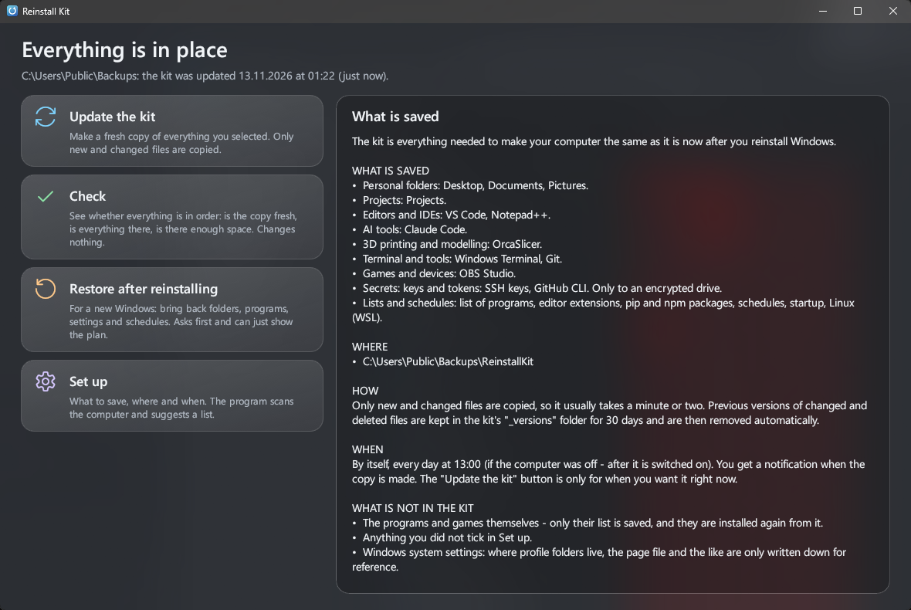

# Reinstall Kit

**English** · [Русский](README.ru.md)

A small Windows program that keeps a ready-to-use "kit" for the day you reinstall Windows:
your folders, projects, program settings, the list of installed programs, schedules and keys.
After the reinstall you open the kit, press one button, and the computer becomes what it was.



## What it does

- **Scans your computer and suggests what to save.** Personal folders at their real location,
  folders with Git projects, settings of known programs (editors, AI tools, 3D-printing slicers,
  terminal, game utilities…), SSH keys and tokens, lists of installed programs, editor extensions,
  pip and npm packages, your Task Scheduler tasks, startup shortcuts, WSL home folders.
  Browser profiles, Wi-Fi networks and drivers are offered as optional items.
  You tick what you want, remove what you do not, and add any folder of your own.
- **Copies to one or two places.** Another drive, an external drive, a network folder.
- **Keeps secrets off unencrypted drives.** With one checkbox, keys, tokens and browser profiles
  are written only to a drive that is really protected by BitLocker - the program checks it.
- **Copies only what is new or changed**, at low priority, so it does not slow the computer down.
  Previous versions of changed and deleted files are kept for 30 days (you choose the number)
  and are then removed, so nothing piles up.
- **Updates itself every day** and shows a short "copy is made" notification.
- **Checks itself.** The Check button changes nothing and prints plain lines: `[ok]` or `[!!]`.
- **Restores.** Puts folders back where they were, installs programs from the list with winget,
  brings back program settings, editor extensions, packages, schedules and startup shortcuts.
  "Just show" mode lists everything it would do without changing anything.
  Restore only adds and replaces files; it never deletes.

## Install

1. Download `ReinstallKit-setup.exe` from the [Releases](../../releases) page and run it.
   Administrator rights are not needed: the program is installed for the current user.
2. The program opens and scans the computer. Tick what to save, choose where, press **Save settings**.
3. Press **Update the kit** once. After that it updates itself every day.

Windows may show a "Windows protected your PC" warning because the installer is not signed.
Press *More info → Run anyway*, or build the program yourself (see below).

Requirements: Windows 10 or 11, 64-bit. Nothing else has to be installed.

## After reinstalling Windows

1. Open the drive with the copy and the `ReinstallKit` folder on it.
2. Run `Open Reinstall Kit.cmd` - the kit carries its own copy of the program.
3. Press **Restore after reinstalling**, then **Just show** to see the plan, then **Restore**.

Program settings are restored best when the programs are already installed, so if something
was not there yet, simply run Restore again later - what is already done is skipped.

## What is inside the kit

```
ReinstallKit\
  files\personal\…      your personal folders
  files\projects\…      project folders
  files\folders\…       folders you added yourself
  files\apps\…          settings of programs
  files\secrets\…       keys and tokens (only on an encrypted drive, if you chose so)
  inventory\            lists: programs, extensions, packages, tasks, startup, system layout
  wsl\                  Linux home folders (weekly archive)
  _versions\2026-01-31\ previous versions of changed and deleted files
  _kit\                 the program itself, for restoring on a clean Windows
  Open Reinstall Kit.cmd
```

Everything is stored as ordinary files and folders - you can open the kit in Explorer and take
any file out by hand, without the program.

## Settings file

All settings live in one readable file, `settings.json`, next to the program
(by default `%LOCALAPPDATA%\Programs\ReinstallKit`). The **Set up** button rewrites it,
and you can edit it by hand:

| Key | Meaning |
| --- | --- |
| `destinations` | One or two places for the copy. A `ReinstallKit` folder lives inside each. The place is found by the marker file `ReinstallKit\.reinstallkit-disk`, not by the drive letter - see below. |
| `secretsOnlyEncrypted` | `true`: items marked `secret` go only to a BitLocker-protected drive. |
| `keepVersionsDays` | How many days previous versions of files are kept. |
| `schedule` | `enabled` and `time` of the daily update. |
| `notify` | Show the notification after an automatic update. |
| `excludeAlways` | Patterns skipped in personal, project and own folders (`node_modules`, `venv`…). |
| `inventory` | Which lists to save: programs, extensions, packages, tasks, startup, wsl, wifi, drivers. |
| `items` | What to save. `path` - where it is on the computer, `dest` - folder inside the kit, `exclude` - patterns to skip, `files` - save only these files, `secret` / `secretFiles` - what counts as a secret. |

**Which disk gets the copy.** Windows gives drive letters in the order disks are plugged in, so after you
connect another disk the letter written in `settings.json` may belong to somebody else's disk. Reinstall Kit
therefore copies only to a place that has the hidden marker file `.reinstallkit-disk` inside its `ReinstallKit`
folder, wherever the disk's letter is now (a changed letter is shown in the log and fixed in the settings
the next time you press **Save settings**). No marker, or the marker on two disks: nothing is copied and no
folder is created. The marker is written only by you: **Set up -> Save settings** asks about each disk that has
none, or run `ReinstallKit.exe --mark G:\Backups`. This matters most for the automatic run that starts whenever
a drive is connected: it can never fill a disk you did not choose.

Skip patterns: `/logs/**` counts from the top of the folder, `node_modules/**` or `*.tmp` match at any depth;
`*` stays inside one folder name, `**` crosses folders. Letter case does not matter.

The list of known programs is built into the program ([assets/catalog.json](assets/catalog.json)).
To add your own, put a `catalog.json` of the same form next to the program - its entries are added to
the built-in ones and appear in **Set up** whenever their folder exists. Pull requests with new entries are welcome.

## What it does not do

- It does not save the programs and games themselves - only the list to install them again.
- It does not change system-level things: where profile folders live, the page file,
  built-in Windows apps. Their state is only written down in `inventory\system-layout.txt`.
- Settings that programs keep in the Windows registry are not saved yet.
- Saved browser passwords cannot be moved to another Windows this way (they are locked to the old one).
- It is not a disk image and not a replacement for a full backup of irreplaceable data.

## Tested and not tested

Tested on Windows 11: build, scanning, setup, updating into a folder, versions and their clean-up,
Check, Restore in "Just show" mode, the installer, the daily task in Task Scheduler, and the automatic run
with its notification.

Not tested yet - treat as a first version: a real restore onto a clean Windows, installing
programs through winget during restore, Wi-Fi and driver export/import,
WSL archives, Windows 10.
Until you have tried a restore yourself, keep another backup of the things you cannot lose.

## How it is made

- Written entirely in Rust. The whole program is one file of about 2.5 MB with nothing to install
  and no helper scripts; the kit carries a copy of it, so restore works on a clean Windows with no internet.
- The window is drawn with [egui](https://github.com/emilk/egui) and uses the Windows 11 frosted-glass backdrop
  (on Windows 10 it falls back to a plain dark background).
- Copying is the program's own small engine ([src/sync.rs](src/sync.rs)): it compares size and modification
  time, copies through a temporary name so an interrupted copy never leaves a half-written file,
  and moves replaced or deleted files to `_versions` instead of deleting them.
- For some jobs it calls tools that Windows or you already have: `winget`, `code`, `pip`, `npm`, `git`, `wsl`,
  `netsh`, `pnputil`, `reg`. Nothing is downloaded.
- Texts are in [assets/lang](assets/lang); the catalog of programs is in [assets/catalog.json](assets/catalog.json).

| File | What it does |
| --- | --- |
| `src/scan.rs` | looks at the computer and suggests what to save |
| `src/update.rs` | "Update the kit" |
| `src/check.rs` | "Check" |
| `src/restore.rs` | "Restore after reinstalling" |
| `src/sync.rs` | copying, versions, skip patterns (with tests) |
| `src/sys.rs` | everything that talks to Windows: BitLocker, Task Scheduler, notification |
| `src/ui.rs` | the window |

The program also has a few command-line switches (it never opens a console; redirect the output to see it):
`--update`, `--update-dry`, `--check`, `--restore-dry <kit folder>`, `--scan`, and `--auto`, which Task Scheduler uses.

### Build

You need [Rust](https://rustup.rs). With the GNU toolchain (`x86_64-pc-windows-gnu`) a full MinGW-w64,
for example [WinLibs](https://winlibs.com), must also be on `PATH`; with the MSVC toolchain, the Visual Studio Build Tools.

```powershell
cargo test --release                                           # tests of the copying engine
powershell -ExecutionPolicy Bypass -File build.ps1             # program -> dist\ReinstallKit
powershell -ExecutionPolicy Bypass -File build.ps1 -Installer  # + dist\ReinstallKit-setup.exe (needs Inno Setup 6)
```

`build.ps1` only runs `cargo build --release`, copies the program and writes the icon into it.

## Licence

[GPL-3.0](LICENSE). The program is built from open-source Rust libraries listed in [Cargo.toml](Cargo.toml),
each under its own permissive licence (MIT, Apache-2.0 and similar).
