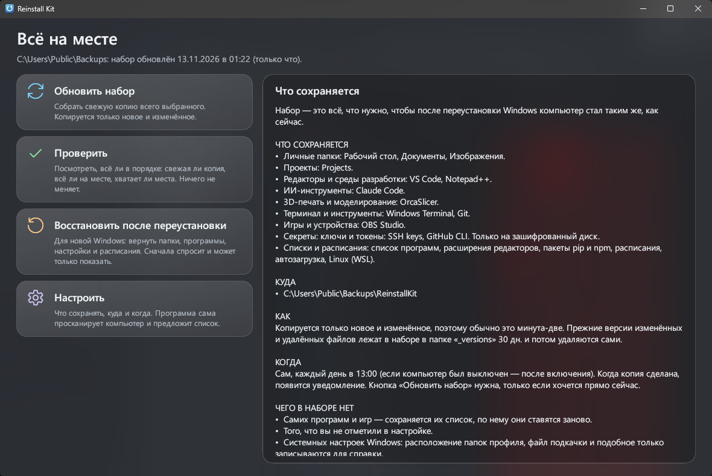

# Reinstall Kit

[English](README.md) · **Русский**

Небольшая программа для Windows, которая держит наготове «набор» на день, когда придётся
переустанавливать Windows: ваши папки, проекты, настройки программ, список установленных программ,
расписания и ключи. После переустановки вы открываете набор, нажимаете одну кнопку —
и компьютер становится таким, каким был.



## Что она умеет

- **Сама сканирует компьютер и предлагает, что сохранить.** Личные папки по их настоящему
  расположению, папки с проектами Git, настройки известных программ (редакторы, ИИ-инструменты,
  слайсеры для 3D-печати, терминал, игровые утилиты…), ключи SSH и токены, список установленных
  программ, расширения редакторов, пакеты pip и npm, ваши задачи планировщика, ярлыки автозагрузки,
  домашние папки WSL. Профили браузеров, сети Wi-Fi и драйверы предлагаются как необязательные пункты.
  Нужное отмечаете галочкой, лишнее убираете, любую свою папку добавляете.
- **Сохраняет в одно или два места.** Другой диск, внешний диск, сетевая папка.
- **Не кладёт секреты на незашифрованный диск.** Одна галочка — и ключи, токены и профили браузеров
  пишутся только на диск, который действительно защищён BitLocker. Программа это проверяет.
- **Копирует только новое и изменённое**, с низким приоритетом, чтобы не тормозить компьютер.
  Прежние версии изменённых и удалённых файлов хранятся 30 дней (число можно поменять)
  и потом удаляются сами — ничего не копится.
- **Обновляется сама каждый день** и показывает короткое уведомление «копия сделана».
- **Проверяет себя.** Кнопка «Проверить» ничего не меняет и пишет простыми строками: `[ок]` или `[!!]`.
- **Восстанавливает.** Возвращает папки на прежние места, ставит программы по списку через winget,
  возвращает настройки программ, расширения редакторов, пакеты, расписания и ярлыки автозагрузки.
  Режим «Только показать» перечисляет всё, что будет сделано, ничего не меняя.
  При восстановлении файлы только добавляются и заменяются, ничего не удаляется.

## Установка

1. Скачайте `ReinstallKit-setup.exe` со страницы [Releases](../../releases) и запустите.
   Права администратора не нужны: программа ставится для текущего пользователя.
2. Программа откроется и просканирует компьютер. Отметьте, что сохранять, выберите, куда,
   и нажмите **«Сохранить настройки»**.
3. Один раз нажмите **«Обновить набор»**. Дальше он обновляется сам, каждый день.

Windows может показать предупреждение «Система Windows защитила ваш компьютер», потому что
установщик не подписан. Нажмите *Подробнее → Выполнить в любом случае* или соберите программу
сами (см. ниже).

Требования: Windows 10 или 11, 64-разрядная. Больше ничего ставить не нужно.

## После переустановки Windows

1. Откройте диск с копией и папку `ReinstallKit` на нём.
2. Запустите `Open Reinstall Kit.cmd` — в наборе лежит своя копия программы.
3. Нажмите **«Восстановить после переустановки»**, затем **«Только показать»**, чтобы увидеть план,
   затем **«Восстановить»**.

Настройки программ лучше всего возвращаются, когда сами программы уже установлены. Если чего-то
ещё не было — просто запустите восстановление ещё раз позже: уже сделанное пропускается.

## Что лежит в наборе

```
ReinstallKit\
  files\personal\…      личные папки
  files\projects\…      папки с проектами
  files\folders\…       папки, которые вы добавили сами
  files\apps\…          настройки программ
  files\secrets\…       ключи и токены (только на зашифрованном диске, если вы так выбрали)
  inventory\            списки: программы, расширения, пакеты, расписания, автозагрузка, схема системы
  wsl\                  домашние папки Linux (архив раз в неделю)
  _versions\2026-01-31\ прежние версии изменённых и удалённых файлов
  _kit\                 сама программа — чтобы восстановиться на чистой Windows
  Open Reinstall Kit.cmd
```

Всё хранится обычными файлами и папками: набор можно открыть в Проводнике и достать любой файл
руками, без программы.

## Файл настроек

Все настройки лежат в одном читаемом файле `settings.json` рядом с программой
(по умолчанию `%LOCALAPPDATA%\Programs\ReinstallKit`). Кнопка **«Настроить»** его переписывает,
но править можно и руками:

| Ключ | Что значит |
| --- | --- |
| `destinations` | Одно или два места для копии. В каждом создаётся папка `ReinstallKit`. |
| `secretsOnlyEncrypted` | `true`: пункты с пометкой `secret` идут только на диск под BitLocker. |
| `keepVersionsDays` | Сколько дней хранить прежние версии файлов. |
| `schedule` | `enabled` и `time` — ежедневное обновление. |
| `notify` | Показывать уведомление после автоматического обновления. |
| `excludeAlways` | Что пропускать в личных папках, проектах и своих папках (`node_modules`, `venv`…). |
| `inventory` | Какие списки сохранять: programs, extensions, packages, tasks, startup, wsl, wifi, drivers. |
| `items` | Что сохранять. `path` — где это на компьютере, `dest` — папка внутри набора, `exclude` — что пропускать, `files` — сохранять только эти файлы, `secret` / `secretFiles` — что считается секретом. |

Шаблоны пропуска: `/logs/**` считается от начала папки, `node_modules/**` или `*.tmp` срабатывают на любой глубине;
`*` не выходит за имя одной папки, `**` — выходит. Регистр букв не важен.

Список известных программ встроен в программу ([assets/catalog.json](assets/catalog.json)).
Чтобы добавить своё, положите рядом с программой файл `catalog.json` такого же вида — его записи
добавятся к встроенным и появятся в «Настроить», когда на компьютере есть такая папка. Дополнения к каталогу приветствуются.

## Чего программа не делает

- Не сохраняет сами программы и игры — только список, по которому они ставятся заново.
- Не меняет системные вещи: где лежат папки профиля, файл подкачки, встроенные приложения Windows.
  Их состояние только записывается в `inventory\system-layout.txt`.
- Настройки, которые программы хранят в реестре Windows, пока не сохраняются.
- Сохранённые пароли браузеров таким способом на другую Windows не переносятся (они привязаны к старой).
- Это не образ диска и не замена полной резервной копии незаменимых данных.

## Что проверено, а что нет

Проверено на Windows 11: сборка, сканирование, настройка, обновление в папку, версии и их очистка,
проверка, восстановление в режиме «Только показать», установщик, ежедневная задача в планировщике
и автоматический запуск с уведомлением.

Пока не проверено — считайте это первой версией: настоящее восстановление на чистую Windows,
установка программ через winget при восстановлении, сохранение и возврат
сетей Wi-Fi и драйверов, архивы WSL, работа на Windows 10. Пока вы сами не попробовали восстановление, держите ещё одну копию того,
что нельзя потерять.

## Как это сделано

- Целиком на Rust. Вся программа — один файл около 2,5 МБ: ставить ничего не нужно, вспомогательных
  скриптов нет. В наборе лежит её копия, поэтому восстановление работает на чистой Windows без интернета.
- Окно нарисовано с помощью [egui](https://github.com/emilk/egui) и использует «матовое стекло» Windows 11
  (на Windows 10 — обычный тёмный фон).
- Копирует собственный небольшой механизм ([src/sync.rs](src/sync.rs)): сравнивает размер и время изменения,
  копирует через временное имя, чтобы прерванная копия не оставила недописанный файл,
  а заменённые и удалённые файлы не стирает, а переносит в `_versions`.
- Для некоторых дел вызывает то, что уже есть в Windows или у вас: `winget`, `code`, `pip`, `npm`, `git`, `wsl`,
  `netsh`, `pnputil`, `reg`. Ничего не скачивается.
- Тексты — в [assets/lang](assets/lang), каталог программ — в [assets/catalog.json](assets/catalog.json).

| Файл | Что делает |
| --- | --- |
| `src/scan.rs` | смотрит компьютер и предлагает, что сохранить |
| `src/update.rs` | «Обновить набор» |
| `src/check.rs` | «Проверить» |
| `src/restore.rs` | «Восстановить после переустановки» |
| `src/sync.rs` | копирование, версии, шаблоны пропуска (с тестами) |
| `src/sys.rs` | всё, что общается с Windows: BitLocker, планировщик, уведомление |
| `src/ui.rs` | окно |

У программы есть несколько ключей командной строки (консоль она не открывает; чтобы увидеть вывод, перенаправьте его в файл):
`--update`, `--update-dry`, `--check`, `--restore-dry <папка набора>`, `--scan` и `--auto`, которым пользуется планировщик.

### Сборка

Нужен [Rust](https://rustup.rs). С набором GNU (`x86_64-pc-windows-gnu`) в `PATH` должен быть ещё полный MinGW-w64,
например [WinLibs](https://winlibs.com); с набором MSVC — Visual Studio Build Tools.

```powershell
cargo test --release                                           # тесты механизма копирования
powershell -ExecutionPolicy Bypass -File build.ps1             # программа -> dist\ReinstallKit
powershell -ExecutionPolicy Bypass -File build.ps1 -Installer  # + dist\ReinstallKit-setup.exe (нужен Inno Setup 6)
```

`build.ps1` только запускает `cargo build --release`, копирует программу и записывает в неё иконку.

## Лицензия

[GPL-3.0](LICENSE). Программа собрана из открытых библиотек Rust, перечисленных в [Cargo.toml](Cargo.toml);
у каждой своя разрешительная лицензия (MIT, Apache-2.0 и подобные).
